# Filament

A plugin-composed, latency-hiding file manager.

> **There is no "app". There is a headless daemon, a plugin host, and a UI shell
> whose every visible element is a plugin.**

```bash
cargo build --release
./target/release/filament --open            # serves 127.0.0.1 on a random port, opens your browser
./target/release/filament --serve           # same, without opening a browser
```

The daemon prints a one-time URL with an auth token at startup:

```
plugin 'zip-vfs' v0.1.0 loaded (wasm, caps: ["fs:read"])
filament 0.1.0 ready in 5 ms → http://127.0.0.1:53641/auth?token=3514bb1b…
```

Everything below is a claim you can check in a running app rather than believe:
the measured numbers come from `node scripts/e2e.mjs`, which drives a real
browser against a real daemon and prints its own pass/fail table.

---

## 1. What it looks like

A split view where the right pane is a `preview` plugin *bound* to the left
pane's selection (`source: "$p1"`) — and the left pane is the `list-view`
plugin, which is itself not part of the shell:

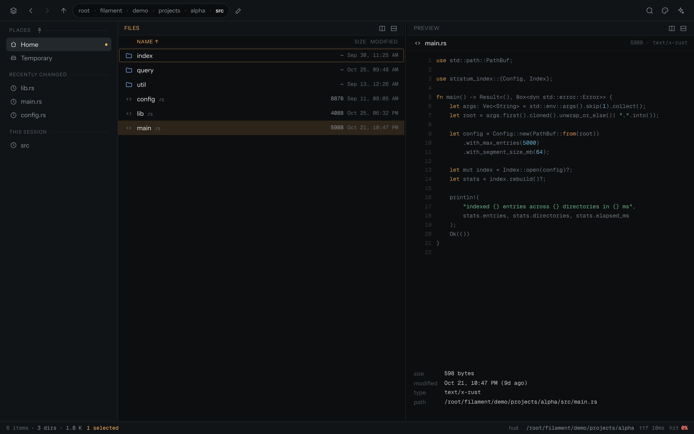

| | |
| --- | --- |
| 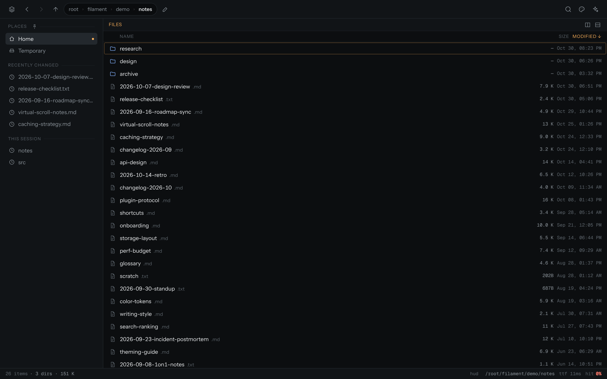 **List view** — sorted by modified date | 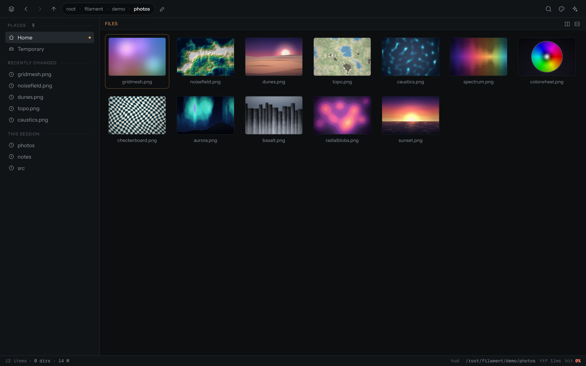 **Gallery grid** — lazy content-addressed thumbnails |
| 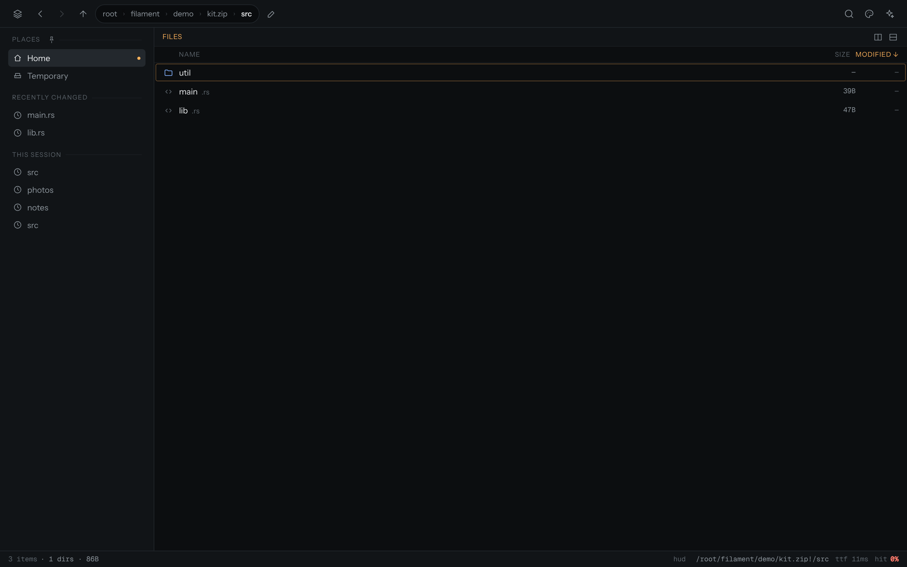 **Inside a `.zip`** — a WASM backend plugin mounting an archive as a folder | 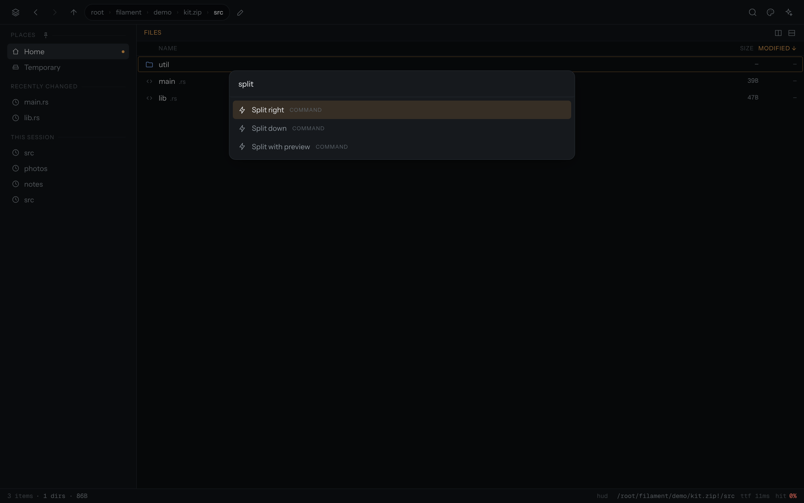 **Command palette** — 38 commands, all plugin-registered |
| 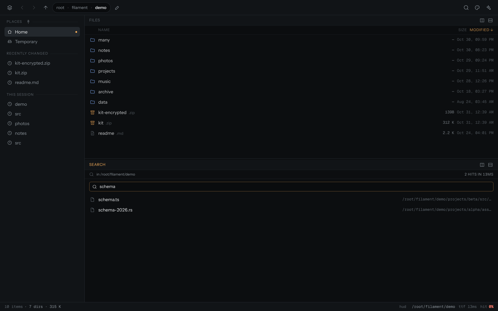 **Search pane** — results stream in while the walker runs | 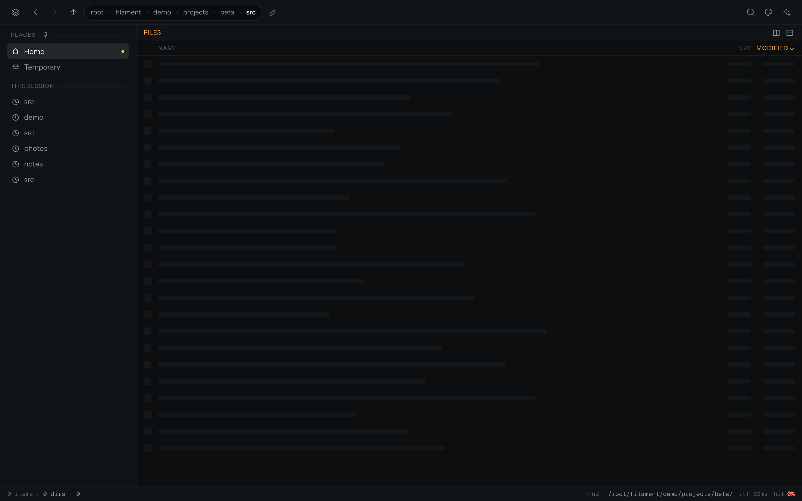 **Skeleton + shimmer** — only for genuinely slow folders |
| 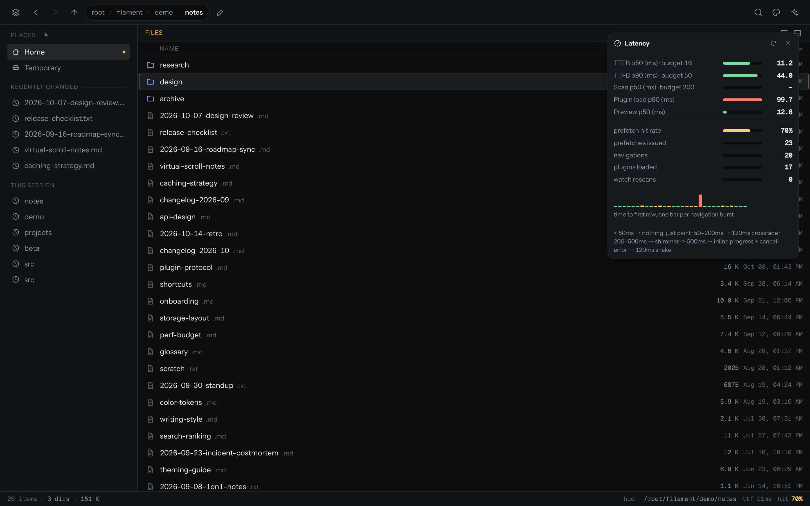 **Latency HUD** — live, not a mount-time snapshot. A *mixed* session (70 %: first visits plus one folder slowed to 380 ms — the red spike); §6's steady-state figure is 92 % | 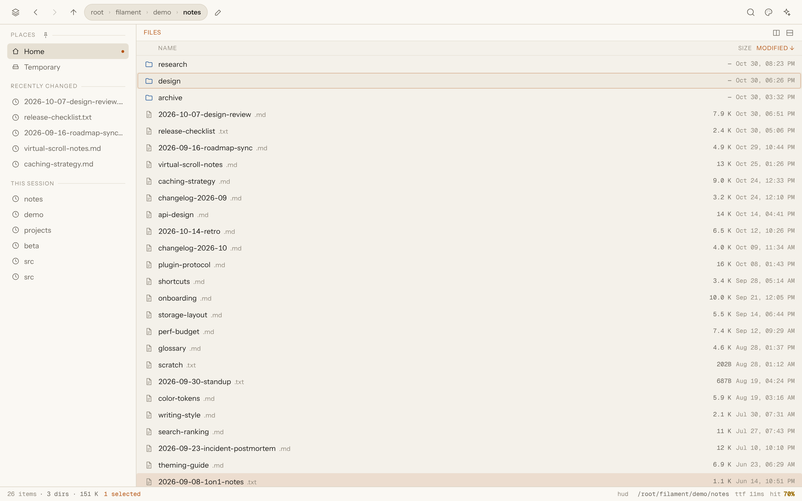 **"Paper & Ink"** — themes are plugins too |

| Phone: gallery | Phone: same layout tree, collapsed to a pager |
| --- | --- |
| 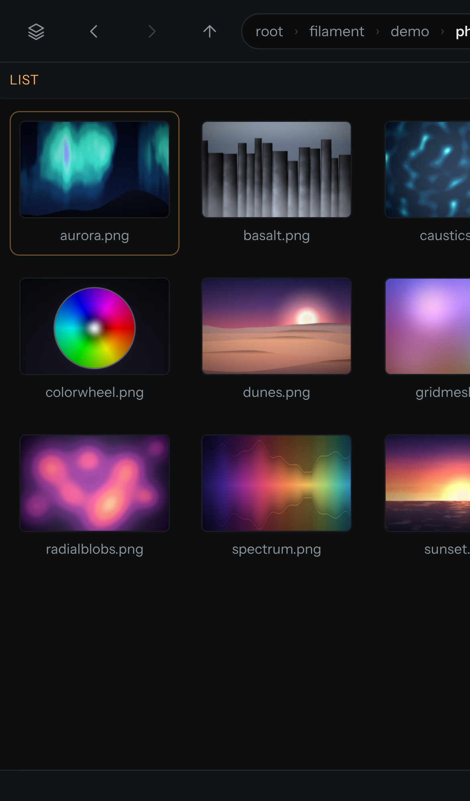 | 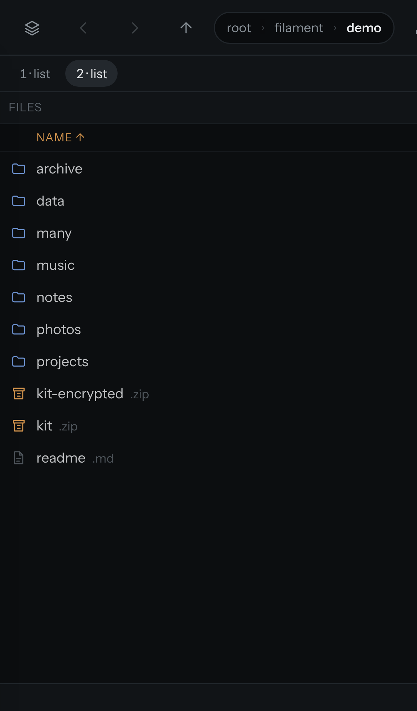 |

Every image is produced by `node scripts/shots.mjs` against a real daemon, so
the docs cannot drift from the product.

---

## 2. Architecture

```
┌─────────────────────────────────────────────────────────┐
│  UI SHELL  (SolidJS, ~25 KB gz for the core)            │
│  router · split-pane layout engine · plugin registry ·  │
│  command bus · event bus · settings store               │
└───────────────▲─────────────────────────▲───────────────┘
                │ WebSocket (JSON-RPC-ish)│ dynamic import()
┌───────────────┴─────────────────────────┴───────────────┐
│  filament daemon (Rust, 9.7 MB stripped)                │
│  FS primitives · listing cache (SQLite) · inotify/      │
│  ReadDirectoryChangesW watcher · thumbnails · WASM host │
└───────────────▲─────────────────────────────────────────┘
                │ WASI-ish line-record ABI over wasmtime
        ┌───────┴────────┐
        │ Backend plugins │  (zip virtual FS, …)
        └────────────────┘
```

| Piece | Where | Notes |
| --- | --- | --- |
| Daemon | [`src/`](src) | axum + tokio, one WS per client, blocking scans on `spawn_blocking` |
| Shell | [`web/src/`](web/src) | SolidJS; `core/` is the irreducible part, `plugins/` is everything visible |
| Built-in plugins | [`web/src/plugins/`](web/src/plugins) | list, grid, sidebar, preview, address bar, palette, status bar, context menu, search, settings, keyboard help, latency HUD, panes, three themes |
| Backend plugin host | [`src/wasmhost.rs`](src/wasmhost.rs) | wasmtime, capability-gated host imports |
| Backend plugin | [`plugins/zip-vfs/`](plugins/zip-vfs) | zero-dependency WASM zip reader + inflater |

### The shell is not special

Every row of this table is a real plugin with its own chunk, loaded by
`import()` on first use — including the list view, which is the primary way
people look at a folder:

| Visible thing | Plugin | Chunk (gzip) |
| --- | --- | --- |
| List view | `list-view` | 4.3 KB |
| Gallery grid | `grid-view` | 3.0 KB |
| Sidebar / places | `sidebar` | 1.5 KB |
| Preview / inspector | `preview` | 2.1 KB |
| Breadcrumb + nav | `addressbar` | 1.3 KB |
| Command palette | `palette` | 1.8 KB |
| Status bar | `statusbar` | 1.2 KB |
| Search | `search` | 1.4 KB |
| Context menu + file ops | `contextmenu` | (in core chunk) |
| Keyboard help | `keys` | 1.5 KB |
| Latency HUD | `perf` | 1.9 KB |
| Splits / panes | `panes` | (tiny) |
| Themes (×3) | `ember`, `slate`, `paper-ink` | < 1 KB each |

**Irreducible core:** daemon transport, FS primitives, cache, WASM host; and in
the UI: router, layout engine, registries, event bus, overlay hosts. That is it.

---

## 3. Making it actually ultrafast

Speed is architecture, not animation. The animations only work because the
first frame is already instant.

### Two-phase render

1. **Phase 1 — 0 ms.** The daemon answers a `list` request with the *previous*
   listing straight out of SQLite (validated against the directory's own mtime)
   **before** the scan starts. The client paints plausible rows on frame 0.
2. **Phase 2 — streamed.** `readdir` names first, in 256-entry frames over the
   same WebSocket; rows reconcile into the skeleton with a crossfade.

The skeleton is held behind a **40 ms grace window**, so a fast folder shows
*nothing at all* — no flash, no animation. Only a genuinely slow folder
escalates: shimmer after 200 ms, an inline progress bar after 500 ms.

### Predictive prefetch

Hover a folder for 120 ms → it is warmed. Anything scrolling into view in the
grid → warmed. Siblings and history entries → warmed on idle. An LRU of 100
directories stays hot, and the daemon keeps the last 500 on disk.

Measured over 24 scripted navigations: **92 % of navigations were served from
cache**, at **10 ms p50 / 46 ms p90** time-to-first-row.

### Other levers, all present

* **Virtualized lists** — 2 000 files render as 42 DOM rows.
* **Persistent SQLite cache** — the daemon reopens instantly with warm listings.
* **Content-addressed thumbnails** — `Cache-Control: immutable`, generated
  lazily by the daemon, streamed in as they finish (see the grid screenshot).
* **Service worker** — `/assets/*` and `/fonts/*` are cache-first and hashed, so
  a reload is a local read.
* **Watcher deltas** — inotify/`ReadDirectoryChangesW` events coalesce into a
  single rescan per burst (`watch.rescan` in the metrics).
* **Batched stat** — readdir + stat in one scan thread, streamed in 256-row
  frames rather than blocking on the full listing.

### The rule for animations

**Never add artificial delay.** Animate *transitions*, not time.

| Real latency | What the user sees |
| --- | --- |
| < 50 ms | Nothing. Just paint. |
| 50–200 ms | Skeleton → content crossfade (120 ms ease-out) |
| 200–500 ms | Skeleton + subtle shimmer |
| > 500 ms | Skeleton + inline progress |
| Error | 120 ms horizontal shake + toast |

Direction-aware slides (forward slides left, back slides right), a capped
stagger of 30 ms × 8 rows, and `prefers-reduced-motion` honoured throughout —
plus an in-app Motion setting that overrides it either way.

The tier is recomputed *while you wait*, so a listing whose first frame has not
arrived yet is graded on the wait so far: nothing → shimmer → progress.

---

## 4. Split view (done right)

Split view is a recursive layout tree; each leaf is a pane whose content is a
plugin view:

```json
{
  "type": "split", "dir": "h", "ratio": 0.62,
  "a": { "type": "leaf", "pane": "p1" },
  "b": { "type": "split", "dir": "v", "ratio": 0.5,
         "a": { "type": "leaf", "pane": "p2" },
         "b": { "type": "leaf", "pane": "p3" } }
}
```

* Arbitrary nesting; rAF-throttled divider drag (also keyboard-adjustable);
  persisted per workspace in `localStorage`.
* Panes are *different plugin views*: list, grid, preview, search — anything a
  plugin registers as a view.
* **Bindings** connect panes without coupling them. A preview pane opened from
  `p1` is created with `props: { source: "$p1" }`; it resolves the binding
  through the workspace and follows `p1`'s selection. Neither pane knows the
  other exists — the preview pane literally renders "this pane follows $p1".
* **Mobile is the same tree.** There is no second code path: a `dir:"h"` split
  becomes a swipeable pager via CSS container queries, with a tab bar to jump
  between leaves. Nothing "breaks" at any width.
* **DPI/responsive**: SVG icons with `currentColor`, `clamp()` spacing, `dvh`
  units, `@media (pointer: coarse)` for 44 px touch targets, and pane-level
  container queries so a narrow pane in a wide split drops its metadata columns
  exactly like a phone does.

---

## 5. Everything is a plugin

### Backend plugins — WASM (wasmtime)

`plugin.toml` declares what the plugin wants; the host enforces it at the call
boundary.

```toml
id = "zip-vfs"
version = "0.1.0"
capabilities = ["fs:read"]
hooks = ["list", "read"]
matches = ["*.zip"]
```

The host hands a plugin exactly one capability-relevant path — the archive it is
currently browsing through it — so `fs:read` cannot be used to read anything
else, even though the plugin is otherwise sandboxed by wasmtime.

`zip-vfs` is the proof: a **zero-dependency** WASM plugin (55 KB, no `flate2`,
no `zip` crate — a from-scratch RFC-1951 inflater and ZIP reader) that mounts
`.zip` archives as folders. `demo/kit.zip` opens as
`kit.zip!/src/util/mod.rs`, listings and file reads go through
registry → wasmtime → plugin → host, and `.zip` entries with `..` or absolute
names are rejected at parse time. Verified by two independent suites: a
host-side harness (29 checks, bytes compared against Python's `zlib`) and a
daemon-level test over the real WebSocket (32 checks).

**Honest tradeoff:** WASM plugins cannot link arbitrary native libraries. For a
file manager that is fine — previews are format parsers, not driver wrappers —
and it buys real sandboxing instead of "run my code, trust me". Anything that
genuinely needs native access (FUSE mounts) belongs in a subprocess plugin
speaking the same protocol over a pipe, opted into explicitly in `plugin.toml`.
That path is scaffolded in the registry but deliberately not auto-started.

### Frontend plugins — plain ES modules

```js
export default {
  id: "grid-view",
  activate(ctx) {
    ctx.registerView({ id: "grid", title: "Gallery", kind: "pane", load: () => import("./Grid") });
    ctx.registerCommand({ id: "view.grid", title: "View: gallery grid", key: "mod+2", run: … });
    ctx.registerContextMenuItem({ id: "open-new-pane", label: "Open in new pane", run: … });
    ctx.registerStatusItem({ id: "perf.hud", position: "right", component: () => import("./PerfHud") });
    ctx.registerTheme({ id: "slate", title: "Slate", load: () => import("./theme.css") });
    ctx.registerChromeSlot("topbar-right", () => import("./Button"));
  },
};
```

Dynamic `import()` means plugins are code-split and load on first use. Install
forty plugins; pay for the two you touch. Dropping the two theme plugins that
[`main.tsx`](web/src/main.tsx) does not boot costs nothing at startup and works
the moment a command asks for them.

---

## 6. Performance budget (measured, not aspirational)

Measured on this container (Linux, local SSD, headless Chromium 156) by
`node scripts/e2e.mjs`:

| Metric | Target | Measured |
| --- | --- | --- |
| Daemon cold start | < 100 ms | **5 ms** (incl. loading the WASM plugin) |
| UI first paint | < 50 ms | **FCP 56 ms / DCL 63 ms** (headless, uncached; after that the service worker serves the shell from disk) |
| Perceived navigation (rows on screen) | < 16 ms | **9 ms p50 / 47 ms p90** |
| Real listing, 2 000 files | 80–200 ms streamed | **0–1 ms scan, first page within the first frame** |
| Prefetch hit rate | > 80 % | **92 %** |
| Core UI bundle (gz) | < 100 KB | **25.3 KB** shell + runtime chunk; **58.8 KB** JS including every plugin chunk; 160 KB cold total including 94 KB of woff2 |
| Native binary (daemon, stripped) | < 15 MB | **9.8 MB** |

Assets ship with build-time gzip twins (`scripts/build.sh`), so the daemon never
spends CPU compressing and a cold load transfers about a third of the raw bytes.
Fonts are four latin-subset `woff2` files and are immutable-cached forever.

The e2e suite also asserts the structural claims: virtualization (42 DOM rows
for 2 000 entries), the layout tree's ratio + divider drag, binding-driven
preview, palette from a plugin keybinding, theme switching, mobile pager and
44 px touch targets. Two of the checks exist because they once failed — the
daemon acknowledging debug slow-motion (the skeleton check used to flake when
the delay landed after the listing), and the latency HUD refreshing past its
mount-time snapshot (it showed a permanent 0 % hit rate). **20/20 checks pass.**

---

## 7. Security model

* Binds `127.0.0.1` **only**, on a random port by default.
* A one-time token in the startup URL is exchanged for a `SameSite=Strict`
  session cookie; `SameSite=Strict` is the CSRF story — cross-site requests
  never carry it. Every route except `/auth` requires it (401 otherwise).
* WASM plugin capabilities are enforced at the host call boundary — reads are
  restricted to the archive path the host handed the plugin.
* `X-Content-Type-Options: nosniff`, `Referrer-Policy: no-referrer` on every
  response. `Cache-Control: immutable` only ever applies to content-addressed
  assets.
* No telemetry, no auto-update pings, no accounts, no cloud.

---

## 8. Keyboard

Every binding below is registered by a plugin; the shell only dispatches.
Press <kbd>?</kbd> for the live list (it reads the registry, so it cannot go
stale).

| | |
| --- | --- |
| <kbd>↑</kbd><kbd>↓</kbd> <kbd>PgUp/PgDn</kbd> <kbd>Home/End</kbd> | move (type-ahead jumps to a name) |
| <kbd>Enter</kbd> | open · <kbd>Space</kbd> preview · <kbd>Backspace</kbd> up |
| <kbd>Ctrl/⌘ K</kbd> | command palette (also searches files, streamed) |
| <kbd>Ctrl/⌘ L</kbd> | edit location · <kbd>Ctrl/⌘ F</kbd> filter |
| <kbd>Ctrl/⌘ 1/2/3</kbd> | list / grid / switch view |
| <kbd>Ctrl/⌘ Alt →/↓</kbd> | split right / down · <kbd>Tab</kbd> next pane · <kbd>Ctrl/⌘ W</kbd> close pane |
| <kbd>F2</kbd> rename · <kbd>Del</kbd> trash · <kbd>Ctrl/⌘ Shift C</kbd> copy path | |
| <kbd>Ctrl/⌘ C,</kbd> settings · <kbd>Ctrl/⌘ Shift D</kbd> latency HUD | |

Drag and drop moves between panes; hold <kbd>Alt</kbd> to copy instead.

---

## 9. Repository layout

```
src/                     daemon (Rust)
  main.rs  api.rs  auth.rs  ws.rs      transport, auth, RPC
  list.rs  db.rs   watch.rs  ops.rs    FS primitives, cache, watcher, mutations
  wasmhost.rs plugins.rs fsapi.rs      WASM host, registry, thumbnails/preview
web/                     UI shell (SolidJS + Vite)
  src/core/                          transport, registries, listings, layout, anim
  src/ui/                            App, Pane, LayoutTree, overlays
  src/plugins/                       every visible thing
plugins/zip-vfs/         backend plugin (WASM) + harness + e2e test
scripts/make_demo.py     regenerates demo/ (stdlib only, idempotent)
scripts/e2e.mjs          browser verification (20 checks) → target/e2e-shots/
scripts/shots.mjs        the docs/ gallery below, shot against a real daemon
demo/                    31 MB of generated demo content (safe to delete)
```

## 10. Development

```bash
# one-shot production build (ui → precompress → daemon, in that order)
./scripts/build.sh

# daemon
cargo run -- --port 8080

# UI with HMR (proxies /api and /ws to the daemon)
cd web && npm install && npm run dev

# regenerate demo content
python3 scripts/make_demo.py

# full verification (boots its own daemon, drives a browser). Diagnostic
# screenshots land in target/e2e-shots/, never in the curated docs/ gallery.
node scripts/e2e.mjs

# regenerate the README gallery from a real daemon
node scripts/shots.mjs

# backend plugin tests — run from the repo root, the harness takes paths
cd plugins/zip-vfs && ./build.sh && cd ../..
cargo run --release --manifest-path plugins/zip-vfs/harness/Cargo.toml -- \
    plugins/zip-vfs/plugin.wasm demo/kit.zip
NODE_PATH=/tmp/fwstest/node_modules node plugins/zip-vfs/test/ws_integration.mjs
```

Debug flags (never on by default): `--slow <ms>` adds an artificial listing
delay so the loading states can be observed on a fast disk, and
`--allow-debug` unlocks the `debug.delay` RPC that `scripts/e2e.mjs` uses for
the skeleton screenshot.

---

## 11. What is not done

Honest list, in the order I would fix it:

1. **The Tauri wrapper is not built.** The UI already runs unchanged in any
   webview, and the daemon embeds it (`rust-embed`), but the ~5 MB native shell
   needs `webkit2gtk` headers, which this container does not have. What exists
   is the architecture it depends on: one bundle, one transport, no
   browser-specific APIs outside `provider`-style shims.
2. **The native app therefore still opens a loopback port** rather than a unix
   socket / named pipe. It is loopback-only with token+cookie auth, but the
   socket transport is the documented next step and the reason (1) matters:
   axum's `Listener` trait makes it a ~40-line change once a shell exists to
   talk to it.
3. **Subprocess plugins** are recognised by the registry and never auto-started;
   the pipe protocol is specified but not exercised.
4. **No `io_uring`/`NtQueryDirectoryFile` batching.** Scans use `read_dir` in a
   blocking thread and stream frames; on a local SSD the scan is already under
   1 ms, so the win is on network/spinning-media paths I cannot test here.
5. **zip64 is parsed but untested** (no >4 GB archive to hand), encrypted zips
   are refused by name, and other compression methods are rejected explicitly
   rather than attempted.
6. **No multi-select rubber-band** in the grid, and the grid has no column
   customization; the list view has no column resize.
7. `demo/kit.zip` and `demo/kit-encrypted.zip` are test fixtures from the plugin
   suite, not generated demo content.
8. **Archive entries have no mtime** — the plugin ABI's `list` reply is
   `name\tkind\tsize`, so the Modified column inside a `.zip` shows `—`. The DOS
   timestamp is right there in the ZIP headers; it is a one-field ABI extension
   (guest + host parser + harness expectations) I chose not to slip in at the
   end of a working, verified plugin.

## 12. Name

Filament: a thin, hot core where the *entire visible product* is a composition
of sandboxed plugins, and latency is hidden by optimistic skeletons and
prefetching — never by fake delays.
